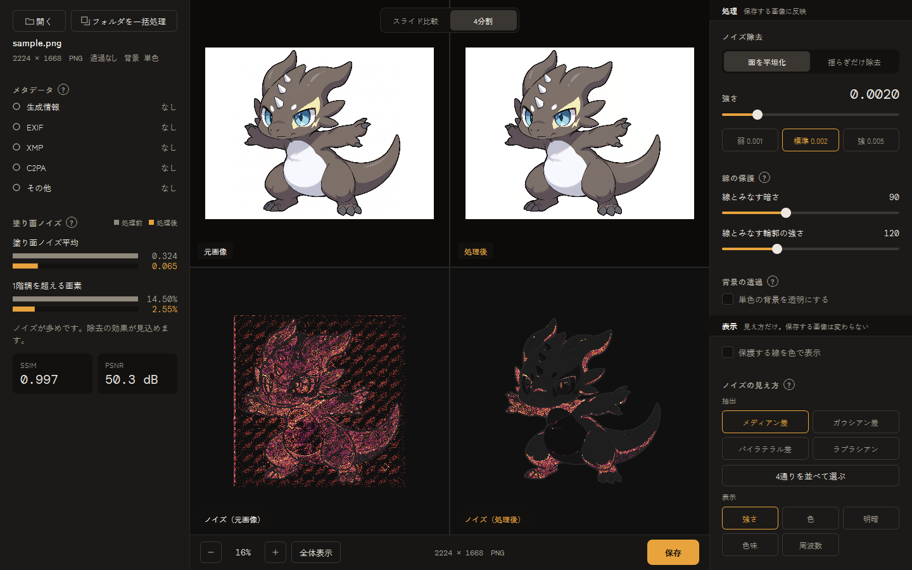
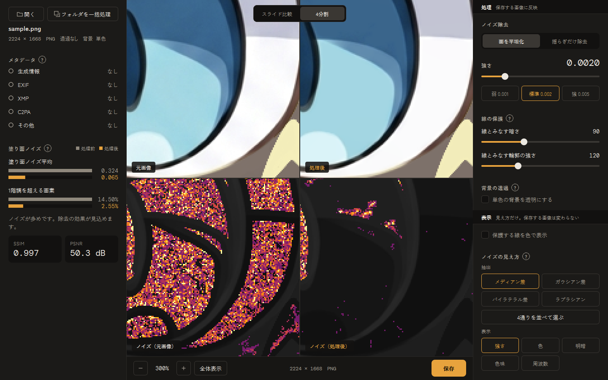
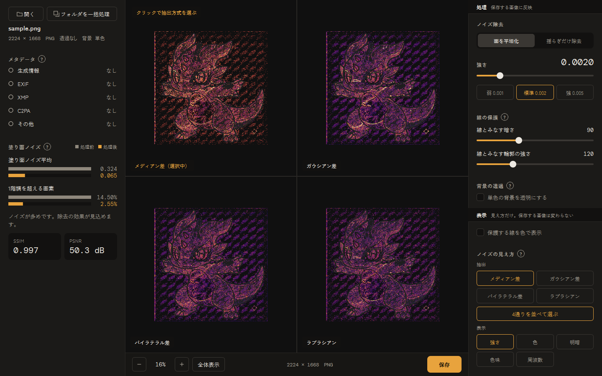

# ai-illust-cleaner

Stable Diffusion などで生成したイラストを、公開前にきれいにするツール。

- **メタデータの確認と消去**：プロンプト・シード値・モデル名などの生成情報が残っていないかを確認し、画素を変えずに消せる
- **塗り面ノイズの可視化と除去**：VAE由来の細かな色ムラを見える形にし、線を保ったまま除去する
- **背景の透過**：単色背景を透明にする





## セットアップ

[uv](https://docs.astral.sh/uv/) を使う。

```powershell
uv sync
```

## 使い方

### GUI

```powershell
uv run python -m gui              # 起動（画像はドラッグ＆ドロップ、フォルダを落とすと一括処理）
uv run python -m gui 画像.png     # 画像を開いて起動
```

画像を開くと、すぐに標準の設定でノイズ除去した結果が出る。画面は1つで、

- **左**：ファイル（開く・フォルダを一括処理）、メタデータ、塗り面ノイズの処理前後と SSIM・PSNR
- **中央**：スライド比較か4分割で、処理前後とそれぞれのノイズを見比べる
- **右**：上の「処理」（ノイズ除去・線の保護・背景の透過）は保存する画像に反映される。下の「表示」（保護する線の表示・ノイズの見え方）は見え方だけを変える
- **保存**：下の「保存」ボタン1つ。処理を反映するか元の画像のままにするかと、消すメタデータの種類を選ぶ。元の画像のままにすれば、メタデータを消すだけの保存になる

- **メタデータ**：PNG・JPEG・WebP の、生成情報・EXIF・XMP・C2PA・その他（タイトルやコメントなど）を見分ける
  - 生成情報は A1111 / Forge・ComfyUI・NovelAI・InvokeAI に対応し、プロンプト・ネガティブ・設定に分けて表示する
  - 位置情報（GPS）や XMP の AI 生成の印があれば注意を出す
  - 元の画像のまま保存するときは、ファイルから該当部分だけを取り除くので、画素も形式も変わらない。
    色の情報（ICCプロファイル）は見た目が変わるため残す
- **ノイズの見え方**：ノイズの「抽出」と「表示」を切り替えられる。指標は常にメディアン差で計算する
  - 抽出：メディアン差／ガウシアン差／バイラテラル差／ラプラシアン（拾いやすいノイズの細かさや、線の境目での誤検出の出方が違う）。
    「4通りを並べて選ぶ」で中央が4分割になり、見比べてクリックした方式に決まる
  - 表示：強さ／色（ノイズの色の偏り）／明暗／色味／周波数（規則的なパターンがあると点や格子が浮かぶ）
- **背景の透過**：縁の色を背景とみなし、縁とつながっている同色の部分を透明にする。単色背景のイラスト向け



### コマンドライン

```powershell
uv run denoise.py 入力.png 出力.png                 # 標準
uv run denoise.py 入力.png 出力.png --lam 0.005     # 強め（既定 0.002、弱めは 0.001）
uv run denoise.py 入力.png 出力.png --mode soft     # 控えめ（小さな揺らぎだけ除去）
uv run denoise.py 入力.png 出力.png --cutout        # 単色の背景を透明にする
uv run denoise.py 入力フォルダ 出力フォルダ          # 一括処理
```

メタデータ（PNGテキスト・EXIF・XMP）は既定で引き継ぐ。不要なら `--strip-meta`（色の情報は残る）。
`tools/` にノイズの可視化・処理前後の比較・メタデータ確認（`inspect_meta.py`）のスクリプトがある。

```powershell
uv run pytest    # テスト
```

## 仕組み

1. 暗い画素と強い勾配から線を検出し、線は元画像のまま保護する
2. 線以外に L0 スムージングをかけ、VAE由来の細かな色ムラを平坦化する
3. 境目を細いフェザーでなじませて合成する

`docs/sample.png` を標準設定で処理した結果（上：拡大、下：色ノイズを60倍に強調）:


| | 塗り面ノイズ平均 | 1階調超の画素 | SSIM（元画像比） |
|---|---|---|---|
| 元画像 | 0.325 | 14.51% | — |
| 標準（lam 0.002） | 0.065 | 2.55% | 0.997 |

## 対象と限界

- 対象は VAE 由来の ±1階調程度の塗り面ノイズ。ノイズ平均が 0.5 を超えるような強いカラーノイズは対象外で、
  左パネルにその旨を表示する
- L0 はやわらかいグラデーションや頬染めも平坦にしやすい。厚塗り系は強さを下げる
- 線の揺らぎ・入り抜き・太さの均一さは変わらない
- JPEG経由の画像はブロックノイズが混ざるため想定外
