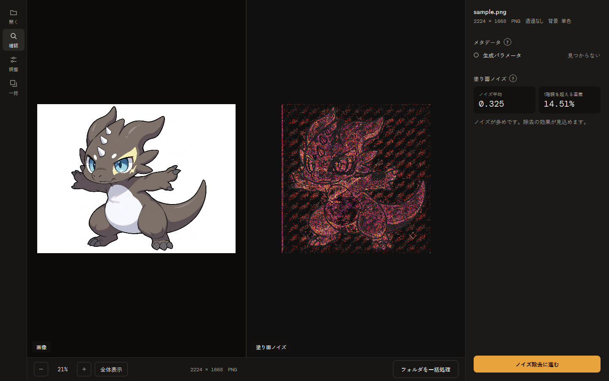

# ai-illust-cleaner

Stable Diffusion などで生成したイラストを、公開前にきれいにするツール。

- **メタデータの確認と消去**：プロンプト・シード値・モデル名などの生成情報が残っていないかを確認し、画素を変えずに消せる
- **塗り面ノイズの可視化と除去**：VAE由来の細かな色ムラを見える形にし、線を保ったまま除去する
- **背景の透過**：単色背景を透明にする




## セットアップ

[uv](https://docs.astral.sh/uv/) を使う。

```powershell
uv sync
```

## 使い方

### GUI

```powershell
uv run python -m gui              # 起動（画像はドラッグ＆ドロップ、フォルダを落とすと一括処理）
uv run python -m gui 画像.png     # 画像を開いて起動
```

- **確認**：生成情報が残っているかと、塗り面ノイズの量を見る。「メタデータを消して保存」は画素を変えない
- **調整**：強さと方式を変えながら、スライド比較か4分割で処理前後を見比べて保存する
- **背景の透過**：縁の色を背景とみなし、縁とつながっている同色の部分を透明にする。単色背景のイラスト向け

### コマンドライン

```powershell
uv run denoise.py 入力.png 出力.png                 # 標準
uv run denoise.py 入力.png 出力.png --lam 0.005     # 強め（既定 0.002、弱めは 0.001）
uv run denoise.py 入力.png 出力.png --mode soft     # 控えめ（小さな揺らぎだけ除去）
uv run denoise.py 入力.png 出力.png --cutout        # 単色の背景を透明にする
uv run denoise.py 入力フォルダ 出力フォルダ          # 一括処理
```

PNGメタデータは既定で引き継ぐ。不要なら `--strip-meta`。
`tools/` にノイズの可視化・処理前後の比較・メタデータ確認のスクリプトがある。

## 仕組み

1. 暗い画素と強い勾配から線を検出し、線は元画像のまま保護する
2. 線以外に L0 スムージングをかけ、VAE由来の細かな色ムラを平坦化する
3. 境目を細いフェザーでなじませて合成する

`docs/sample.png` を標準設定で処理した結果（上：拡大、下：色ノイズを60倍に強調）:


| | 塗り面ノイズ平均 | 1階調超の画素 | SSIM（元画像比） |
|---|---|---|---|
| 元画像 | 0.325 | 14.51% | — |
| 標準（lam 0.002） | 0.065 | 2.55% | 0.997 |

## 対象と限界

- 対象は VAE 由来の ±1階調程度の塗り面ノイズ。ノイズ平均が 0.5 を超えるような強いカラーノイズは対象外で、
  確認画面にその旨を表示する
- L0 はやわらかいグラデーションや頬染めも平坦にしやすい。厚塗り系は強さを下げる
- 線の揺らぎ・入り抜き・太さの均一さは変わらない
- JPEG経由の画像はブロックノイズが混ざるため想定外
