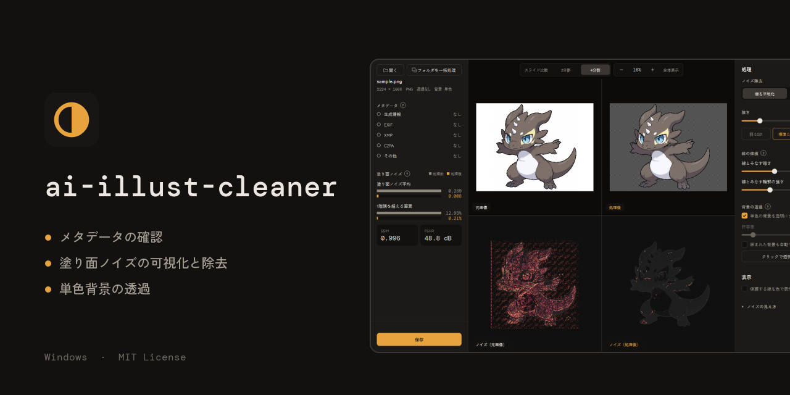
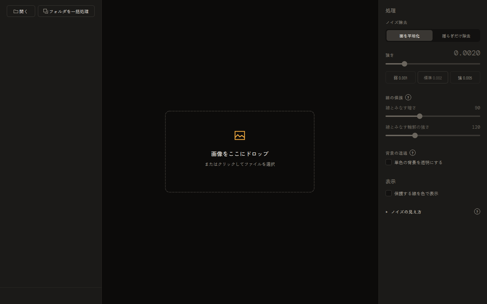
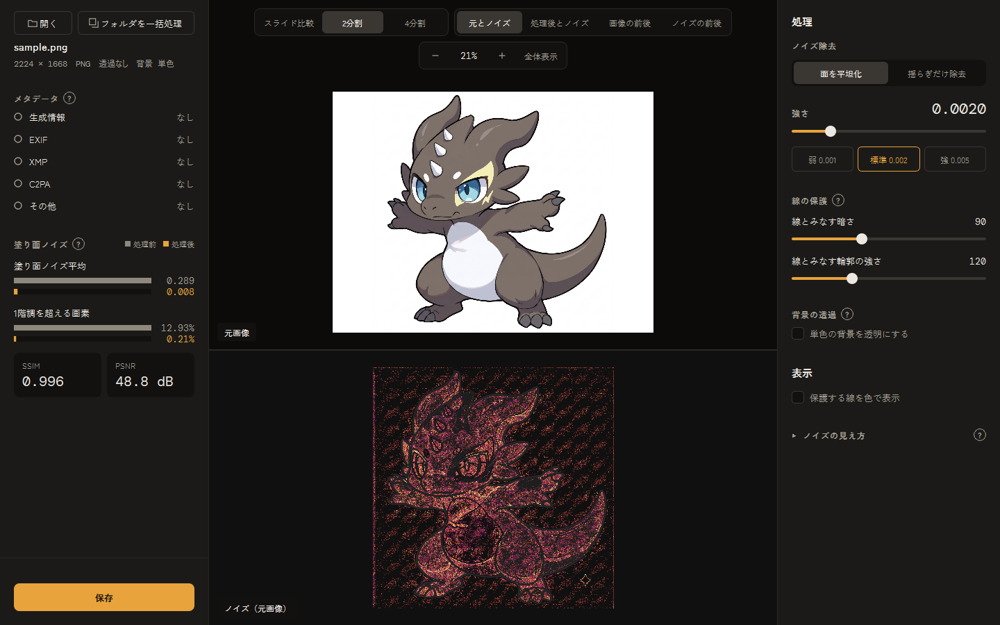
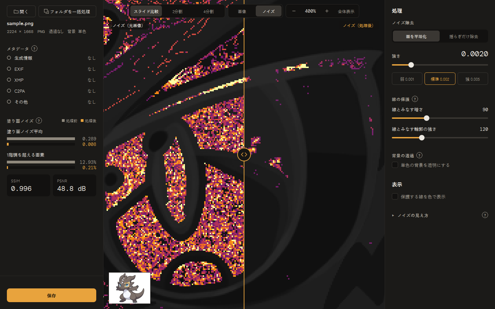

# ai-illust-cleaner

AI生成イラストのメタデータの確認、ノイズの可視化と除去、背景の透過ができる Windows 用のツール。

- **メタデータの確認**：生成情報（プロンプト・シード値・モデル）や EXIF、位置情報などを種類ごとに表示する。不要なものは選んで削除できる
- **ノイズの可視化と除去**：塗りの細かな色ムラ（VAE由来のノイズ）を見える形にし、線を保ったまま除去する
- **背景の透過**：単色の背景を透明にする

## ダウンロード

[Releases](https://github.com/kuronekorou39/ai-illust-cleaner/releases) から zip をダウンロードし、
展開したフォルダの `ai-illust-cleaner.exe` を起動する。インストールは不要（Windows 10 / 11、64bit）。

初回に「Windows によって PC が保護されました」と出たら、「詳細情報」→「実行」を押す（exe に署名をしていないため）。

## 使い方

**1. 画像を取り込む**：起動した画面にドラッグ＆ドロップする（フォルダを落とすと一括処理）

**2. 全体を確かめる**：左にメタデータとノイズの量が出る。中央は2分割や4分割で見比べられる

**3. 拡大して比べる**：スライド比較で処理前後のノイズを見て、右で強さなどを調整する

**4. 保存する**：左下の「保存」で、処理を反映するかと、削除するメタデータを選ぶ

詳しい使い方は [docs/guide.md](docs/guide.md) にある。

## 対応

| | 対応 |
|---|---|
| メタデータ | PNG・JPEG・WebP の生成情報（A1111 / Forge・ComfyUI・NovelAI・InvokeAI）・EXIF・XMP・C2PA |
| ノイズ除去 | PNG・JPEG・WebP など（塗りの細かな色ムラ。保存は PNG） |

## 開発

開発の手順（起動・テスト・exe の作成・リリース）は [docs/development.md](docs/development.md) にある。

## ライセンス

[MIT](LICENSE) © rou39

同梱しているライブラリとフォントのライセンスは [docs/licenses.md](docs/licenses.md) にまとめている。
