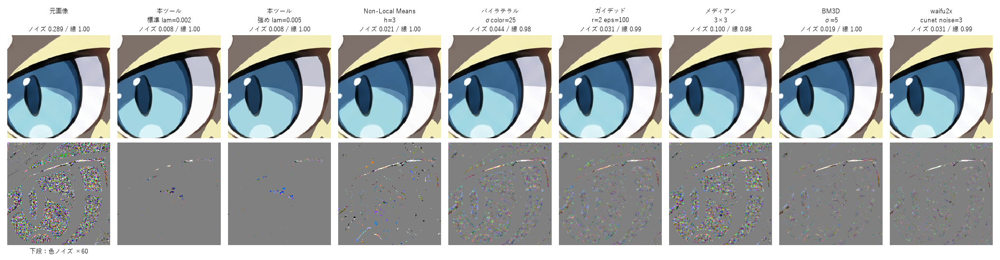
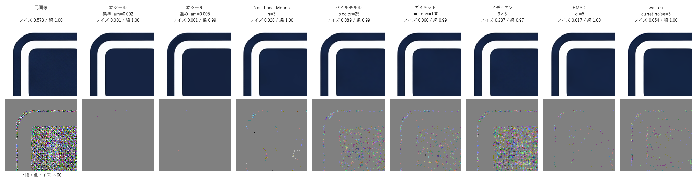

# 他の手法との比較

[README に戻る](../README.md)

同じ画像に、本ツールと一般的なノイズ除去の手法をかけて比べた。

## 比べたもの

| 手法 | 試した設定（太字が下の表と図の設定） |
|---|---|
| 本ツール | **標準 lam=0.002**・**強め lam=0.005** |
| Non-Local Means（OpenCV） | **h=3**・5・10（hColor も同じ値） |
| バイラテラル（OpenCV） | d=7・σspace=3、σcolor=10・**25**・50 |
| ガイデッド（OpenCV contrib） | 自身をガイドに r=2 eps=25・**r=2 eps=100**・r=4 eps=100 |
| メディアン | **3×3** |
| BM3D（`bm3d` パッケージ） | σ=2・**5**・10（0〜255 の階調） |
| waifu2x（`waifu2x-ncnn-py`、CPU） | cunet・拡大なし、noise=0・1・**3** |

各手法の設定は、ノイズと線の残り方の釣り合いが最もよいものを選んだ。全設定の数値は `tools/benchmark.py` で出る。
Real-ESRGAN と Real-CUGAN は未計測。どちらも拡大用のモデルで、等倍のノイズ除去のモデルがないため。

## 指標

- **ノイズ平均・1階調超**：線を除いた塗り面の、7×7 メディアンとの差（アプリの表示と同じ計算）。低いほどきれい
- **SSIM・PSNR**：元画像との近さ。高いほど絵が変わっていない
- **線の保持**：線の画素（本ツールの線マスク）での Sobel 勾配の平均を、元画像と比べた比。1.0 で輪郭がそのまま、1 未満はぼけた
- **秒**：CPU での処理時間（Ryzen 9 7950X。waifu2x はモデルの読み込みを除く）

透過画像は白背景に合成してから測った。

## sample.png（SD のイラスト、2224×1668）

| 手法 | ノイズ平均 | 1階調超 | SSIM | PSNR | 線の保持 | 秒 |
|---|---|---|---|---|---|---|
| 元画像 | 0.289 | 12.93% | - | - | 1.000 | - |
| 本ツール 標準 | **0.008** | **0.21%** | 0.996 | 48.8 | 0.999 | 10.1 |
| 本ツール 強め | **0.008** | 0.23% | 0.996 | 46.7 | 0.998 | 9.7 |
| Non-Local Means h=3 | 0.021 | 0.72% | 0.996 | 47.1 | 1.001 | 0.65 |
| バイラテラル σcolor=25 | 0.044 | 1.15% | 0.997 | 50.3 | 0.984 | 0.01 |
| ガイデッド r=2 eps=100 | 0.031 | 0.69% | 0.997 | 53.5 | 0.985 | 0.14 |
| メディアン 3×3 | 0.100 | 3.75% | 0.997 | 49.9 | 0.977 | 0.00 |
| BM3D σ=5 | 0.019 | 0.41% | 0.997 | 53.6 | 0.998 | 42.6 |
| waifu2x noise=3 | 0.031 | 0.34% | 0.996 | 48.4 | 0.993 | 42.1 |

## Gemini のアイコン（JPEG 由来の強いノイズ、368×364）

| 手法 | ノイズ平均 | 1階調超 | SSIM | PSNR | 線の保持 | 秒 |
|---|---|---|---|---|---|---|
| 元画像 | 0.573 | 24.21% | - | - | 1.000 | - |
| 本ツール 標準 | **0.001** | **0.00%** | 0.992 | 44.3 | 0.997 | 0.21 |
| 本ツール 強め | **0.001** | **0.00%** | 0.987 | 38.8 | 0.988 | 0.20 |
| Non-Local Means h=3 | 0.026 | 1.03% | 0.993 | 47.0 | 1.001 | 0.29 |
| バイラテラル σcolor=25 | 0.089 | 1.88% | 0.993 | 46.6 | 0.987 | 0.00 |
| ガイデッド r=2 eps=100 | 0.060 | 1.07% | 0.994 | 49.0 | 0.995 | 0.01 |
| メディアン 3×3 | 0.237 | 8.42% | 0.991 | 41.6 | 0.975 | 0.00 |
| BM3D σ=5 | 0.017 | 0.16% | 0.994 | 50.5 | 1.000 | 2.95 |
| waifu2x noise=3 | 0.054 | 0.52% | 0.991 | 43.3 | 1.001 | 1.52 |

もう1枚、手元の img2img の画像（584×584、非公開）でも測った。ノイズ平均は元が 0.116、本ツール標準が 0.003、BM3D σ=5 が 0.007、ガイデッドが 0.019、バイラテラルが 0.024、Non-Local Means h=3 が 0.035。

## わかったこと

- 塗り面のノイズは本ツールが最も少ない。3枚とも、次点の BM3D の半分以下になった。ただし指標は「周りの中央値との差」なので、面を平らにする本ツールの処理と相性がよい
- 元画像との近さ（PSNR）は BM3D とガイデッドの方が高い。本ツールは L0 で面を平らにするため、緩いグラデーションも段に寄る。強め（lam=0.005）ではこの差が広がる
- 線の保持はどの手法も 0.97 以上で大差はない。ただしこの指標と本ツールの線マスクは同じ判定なので、本ツールに有利に出る。Non-Local Means と BM3D も線をほぼそのまま残した
- 速さはバイラテラル・ガイデッド・Non-Local Means が上。本ツールは 2224×1668 で約10秒かかり、Non-Local Means の約15倍になる。BM3D と waifu2x はさらに遅い
- waifu2x は noise=0・1 では塗りのノイズがほとんど減らず、sample.png ではむしろ増えた（0.289 → 0.314）。JPEG のノイズ向けのモデルで、±1階調のノイズは対象外と見える
