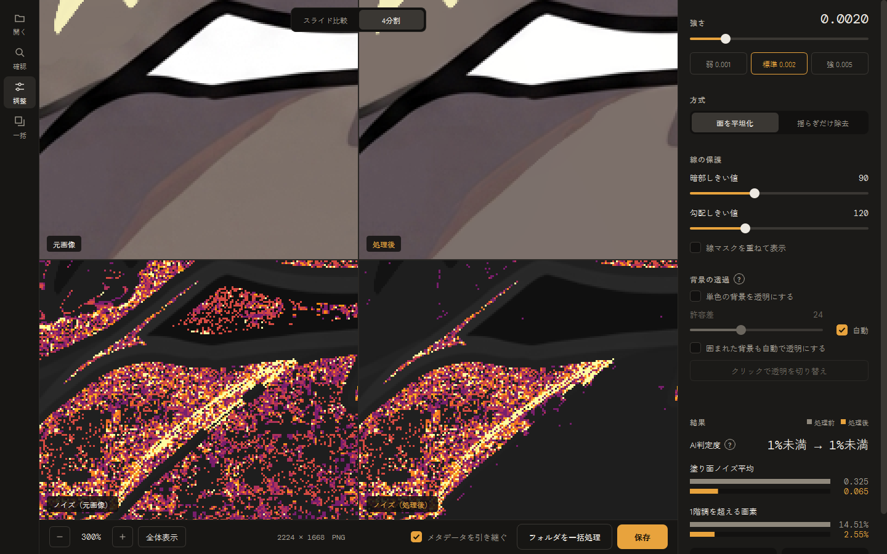
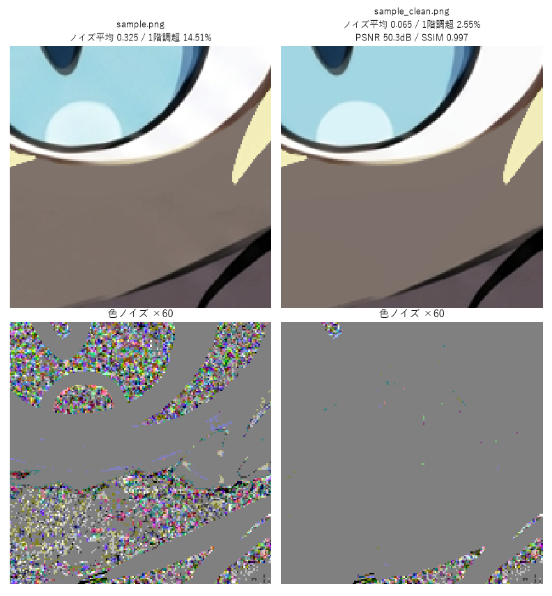
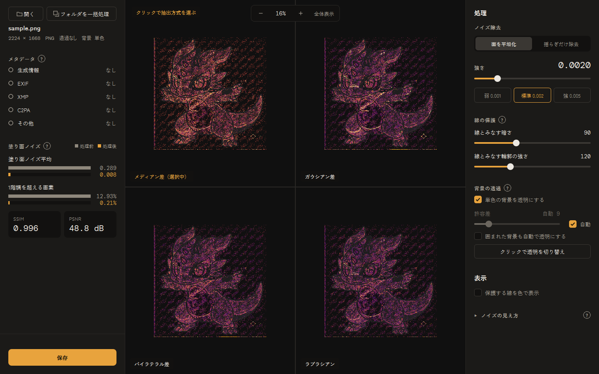

# 使い方の詳細

[README に戻る](../README.md)

## 画面

画像を開くと、すぐに標準の設定でノイズ除去した結果が出る。

- **左**：ファイル（開く・フォルダを一括処理）、メタデータ、ノイズの処理前後の数値、保存
- **中央**：スライド比較・2分割・4分割で、処理前後とそれぞれのノイズを見比べる。2分割では並べる2つを上のボタンで選ぶ。上のボタンで拡大・縮小
- **右**：上の「処理」は保存する画像に反映される。下の「表示」は見え方だけを変える

## メタデータ

画像ファイルに埋め込まれた、画素以外の情報を種類ごとに表示する。

| 種類 | 中身 |
|---|---|
| 生成情報 | プロンプト・ネガティブ・シード値・モデル名など。A1111 / Forge・ComfyUI・NovelAI・InvokeAI に対応 |
| EXIF | 作成ソフト・日時・作者・撮影機器・位置情報など |
| XMP | 編集ソフトが書き込む情報。作者や編集履歴、AI生成の印が入ることもある |
| C2PA | 画像の出どころを証明する、署名付きの情報（コンテンツクレデンシャル） |
| その他 | タイトル・コメント・IPTC・解釈できないデータなど |

- 要約をクリックすると、生成情報（プロンプトと設定に分けたもの）と全項目を見られる
- 位置情報（GPS）や、XMP の「AI生成」の印があれば注意を出す

## 保存

左下の「保存」で、次の2つを選ぶ。

- **画像**：ノイズ除去と透過を反映する（PNG で保存）か、元の画像のままにするか
- **削除するメタデータ**：種類ごとに選ぶ（選ばなかったものは残る）

元の画像のままなら、ファイルから選んだ部分だけを取り除くので、画素も形式も変わらない。
色の情報（ICCプロファイル）と画像の向きは見た目が変わるため、どちらでも残す。C2PA は署名が合わなくなるため、処理を反映するときは引き継がない。
透明度の最下位ビットに埋め込まれた生成情報も「生成情報」として消せる（このときだけ透明度がわずかに変わる）。

## ノイズ除去

1. 暗くて細い部分と、色の変わり方が急な部分を線とみなし、元のまま残す（線の保護）。広い暗い面は塗りとして処理し、輪郭の強さはノイズをならしてから測る
2. 線以外に L0 スムージングをかけ、細かな色ムラを平坦化する（方式「面を平坦化」）
3. 境目をなじませて合成する

- **強さ**：大きいほどベタ塗り寄りになる。やわらかいグラデーションや頬染めが消えるときは下げる
- **揺らぎだけ除去**：面を平坦化せず、小さな揺らぎだけを取る控えめな方式
- **線の保護**：「保護する線を色で表示」で、線とみなした範囲を確かめられる

`docs/sample.png` を標準設定で処理した結果（上：拡大、下：色ノイズを60倍に強調）:

| | ノイズ平均 | 1階調を超える画素 | SSIM（元画像比） |
|---|---|---|---|
| 元画像 | 0.289 | 12.93% | — |
| 標準（強さ 0.002） | 0.008 | 0.21% | 0.996 |

処理した後もノイズ平均が 0.5 を超えるときは、左に注意が出る（原因と、動かすとよい設定も出す）。線の揺らぎや太さは変わらない。

開ける画像は 4096×4096 と同じ画素数（約1680万画素）まで。600万画素を超える画像では全体の処理に時間がかかり、処理中はその旨を中央に出す。上限に近い画像では、全体の処理に1〜2分と4〜5GBほどのメモリを使う。

## ノイズの見え方

右の「ノイズの見え方」で、ノイズの取り出し方と見せ方を切り替える。数値は比べられるよう、常にメディアン差で計算する。
緩いグラデーションの1階調ずつの段差は、ノイズに数えない（周りに同じ値の画素が並んでいる点は、段差の境目とみなす）。

| 抽出 | 特徴 |
|---|---|
| メディアン差 | 周囲の中央値との差。粒状のノイズを広く拾う |
| ガウシアン差 | 近くの平均との差。1〜2画素の細かい粒を強く拾う |
| バイラテラル差 | 似た色だけの平均との差。色の境目の誤検出が少ない |
| ラプラシアン | 上下左右との差（2階微分）。画素単位のざらつきを拾う |

「4通りを並べて選ぶ」で中央が4分割になり、見比べてクリックした方式に決まる。

| 表示 | 見えるもの |
|---|---|
| 強さ | 明るいほどノイズが大きい |
| 色 | ノイズの色の偏り（灰色が0） |
| 明暗・色味 | 明るさのムラと色味のムラを分けて見る |
| 周波数 | 周波数ごとの強さ。点や格子が浮かんだら規則的なノイズ |

## 背景の透過

縁の色を背景とみなし、縁とつながっている同じ色の部分を透明にする。単色背景のイラスト向け。

- **許容差**：背景色とみなす色の差。自動では背景のばらつきのすぐ上に置く。背景が残るときは上げ、淡い塗りが消えるときは下げる
- **囲まれた背景**：腕と体の間などは、「クリックで透明を切り替え」を押してから場所をクリックする。もう一度クリックすると戻る
